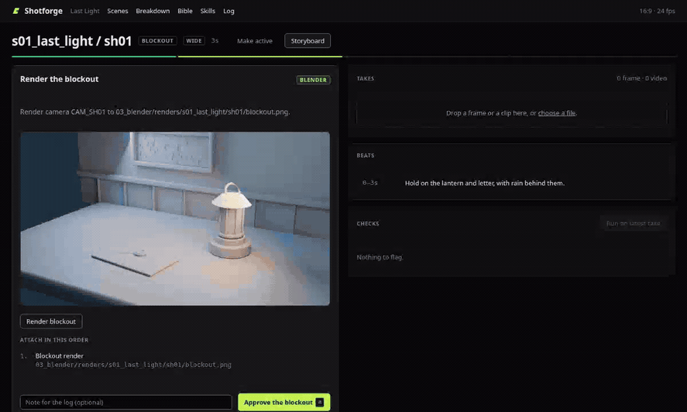

# Shotforge

A local, open-source cockpit that turns book text into AI video scenes, with an
approval gate at every step. It runs on Mac and Windows, uses the subscriptions
you already have (ChatGPT, Grok, Claude) rather than a paid API, and keeps the
whole project in one folder of plain files.

**You are the director.** The system proposes, prepares and checks; every stage
closes only when you approve it, and every approval is logged with your note.

## What works today

A shot can go from a Blender blockout to an approved video without a prompt
being written by hand.

| Area | State |
| --- | --- |
| Project tree, Pydantic schemas, `shotforge new` | done |
| Per-shot state machine with an approval gate at every stage | done |
| Numbered takes, approval copying to the fixed name, approval log | done |
| `_inbox` routing, drag-and-drop onto the shot card | done |
| Prompt skills: `chatgpt-first-frame`, `chatgpt-identity-pass`, `grok-video` | done |
| Code-level QA: aspect ratio, clip duration, camera motion, speech timing, cut continuity | done |
| Visual continuity across approved cuts via Claude Code | done |
| Last-frame extraction feeding the next shot | done |
| Cockpit: Projects, Scenes, Breakdown, Storyboard, Shot card, Takes, Bible, Skills, Log | done |
| Engine layer (`Engine.run_skill`) with a Claude Code implementation | done |
| Blender blockout with named shot cameras and a 180° axis check | done |
| Per-character masks and automatic face crops | done |
| Video vision QA: unplanned lens contact in sampled frames | done |
| Frame vision QA (identity, eyeline, continuity, AI look) | done |
| Chapter breakdown and scene-to-shots skills | done |
| Bible editing, design prompts, and entity approval | done |
| Cinematography skill and technique library | done |
| Rough-cut timeline, sound bridges and CMX 3600 export | done |

## Install

Install [uv](https://docs.astral.sh/uv/getting-started/installation/) and
[FFmpeg](https://ffmpeg.org/download.html), then run:

```sh
uv tool install shotforge
shotforge doctor
```

If the first PyPI release is still pending, use
`uv tool install git+https://github.com/yonigofman/shotforge.git`.
Python 3.11 or later is required. Blender is needed for rendering new blockouts,
and Claude Code is used for optional model-assisted steps. The demo already
includes its renders.

## Try the public demo

[](https://github.com/yonigofman/shotforge/blob/main/docs/demo/walkthrough.mp4)

[Open the shot-card still](https://github.com/yonigofman/shotforge/blob/main/docs/demo/shot-card.png) ·
[Browse the Last Light project](https://github.com/yonigofman/shotforge/tree/main/examples/last_light)

Run these commands from a folder where you can create a new `last_light` directory:

```sh
shotforge demo
shotforge serve -C last_light
```

Open [the first shot](http://127.0.0.1:8765/shot/s01_last_light/sh01) in your
browser. Keep `last_light/downloads` open in your file manager. The supplied
takes let you do the whole walkthrough without signing in to a generator.

1. Choose **Approve the blockout**, then **Start Frames**.
2. On **Pass 1**, use **choose a file** in the **Takes** panel to upload
   `sh01-pass1.png` from `last_light/downloads`.
3. Choose **Go to pass 2 (identity)**. Upload `sh01-pass2.png` the same way.
   Choose **Approve v2**. The approved still is
   saved at `last_light/04_scenes/s01_last_light/shots/sh01/frames/first.png`.
4. To go through video approval, choose **Start Video**, upload `sh01-video.mp4`,
   and choose **Approve the video**. The approved clip appears under
   `video/shot.mp4` in that shot's folder.

## Start your own project

```sh
shotforge serve
```

Open [the cockpit](http://127.0.0.1:8765) and choose **New project**. Fill in
the name, language, aspect ratio, frame rate, and storage. To open an
existing project, enter the folder containing its `project.yaml`. Use the
**Projects** tab to switch between projects. The recent list at
`~/.shotforge/projects.json` stores each project's name and path.
Shotforge reads progress from the project folder.

To create and open a project directly from the terminal:

```sh
shotforge new "My film"
cd my_film
shotforge serve
```

Put your chapter in `00_source/ch01.md` and fill in `01_bible/style.yaml`.
Use `shotforge doctor` to check available tools and `tool_paths` in
`project.yaml` to override their locations.

## Design an entity

1. Open **Bible** and choose **New character**, **New location**, or **New prop**.
   Record details from the chapter in `from_book` and production decisions in
   `design_choices`. The editor validates the same YAML schema as `shotforge validate`.
2. Choose **Generate prompts**. Use the design sheet prompt in ChatGPT, then attach
   the resulting sheet when running the clean reference prompt.
3. Drop each download onto its matching section on the entity card, or pick it
   from the inbox. The cockpit files these as `sheet.png` and `ref.png` under
   `02_design/<kind>s/<id>/`.
4. Review both images and choose **Approve design**. The cockpit records the
   approval in `.shotforge/state.json` and shows it in the log. An entity edit
   or image replacement sends the design back for review.

For a first-frame wall reference, render or generate an empty view of the
location that shows the wall finish and any windows. Save the PNG as
`02_design/locations/<id>/wall_ref.png` in your project. Shotforge lists it
with the Pass 1 attachments and uses it in frame vision QA.

## Start from a chapter

Put the chapter text in `00_source/` as Markdown or plain text. With Claude
Code signed in, open **Breakdown** in the cockpit, choose the chapter and
generate a proposal. The cockpit shows progress as Claude drafts the chapter
and plans shots for each scene. You can cancel while it works. Read the chapter
alongside the proposed scenes, bible entries and shots. Edit the timed beats
in place, then use **Approve and save** to create the reviewed files.

From the terminal, run the two steps separately. Use the scene ID shown in the
first diff for the second command.

```bash
shotforge breakdown ch01
shotforge shots s02_waiting_room
```

Both commands show a YAML diff and ask before saving. Existing IDs are listed
as collisions and skipped. Generated scenes remember their chapter. For a
hand-written scene in a project with multiple chapters, use
`shotforge shots s02_waiting_room --chapter ch01`. New shots start in
`breakdown` and follow the usual approval workflow.

## Configure Claude Code

In the cockpit, open **Settings** to choose the model, thinking effort,
fallback models, and timeout per skill. Shotforge saves the preferences in
`claude.yaml` at the project root. They also apply to CLI commands that run
Claude Code in that project.

```yaml
model: opus
effort: high
fallback_models: [sonnet, haiku]
timeout_s: 900
```

Omit a model option to use Claude Code's default. The available effort levels
depend on the model. With the timeout unset, Shotforge allows 600 seconds per
skill and 120 seconds for video eyeline review.

## How a shot moves

```
breakdown → blockout → frame → video → done
```

Each stage has one gate. `shotforge approve` is the only thing that sets an
`*_approved` status, and `shotforge begin` opens the next stage. Both are written
to `.shotforge/approvals.jsonl` with your note, so you can always go back and see
why something was decided.

The frame stage runs in two passes: pass 1 locks the composition from the Blender
blockout, pass 2 fixes identity against the face crops. Approving ends the stage.
On frame approval, Shotforge uses each character's mask to crop the head from
`first.png` and saves it under `02_design/characters/<id>/face_crops/`. The
shot card shows skipped crops. Pass 2 attaches each character's most recent
approved crop immediately before the current shot's mask.

A full shot, in the terminal:

```bash
shotforge camera  s01_pub sh07                       # review the camera diff
shotforge approve s01_pub sh07 --note "beats fine"   # breakdown
shotforge begin   s01_pub sh07                       # → blockout
shotforge blockout s01_pub sh07                       # render the blockout
shotforge approve s01_pub sh07                       # blockout
shotforge begin   s01_pub sh07                       # → frame
shotforge prompt  s01_pub sh07                       # pass 1 prompt, saved next to the shot
shotforge inbox file chatgpt_result.png              # becomes frames/first_v1.png
shotforge qa      s01_pub sh07 --kind frame          # rerun the report if needed
shotforge approve s01_pub sh07 --take 1              # copies to frames/first.png
shotforge begin   s01_pub sh07                       # → video
shotforge prompt  s01_pub sh07                       # Grok prompt with timecodes
shotforge inbox file grok_result.mp4                 # becomes video/v1.mp4
shotforge approve s01_pub sh07                       # → video/shot.mp4 + last_frame.png
```

## Review a video take

Camera motion and speech checks use the optional `qa` extra. If you launch
Shotforge from GitHub, include it in the `uvx` command.

```sh
uvx --isolated --from "shotforge[qa] @ git+https://github.com/yonigofman/shotforge.git" shotforge serve
```

From a local checkout, use `uv run --extra qa shotforge serve`.
Filing a clip through the inbox or uploading it on the shot card runs QA and
saves the findings to `qa/video_v<n>.json`. Open the QA details beneath the
video take in the cockpit, or rerun the checks from the terminal.

```bash
shotforge qa s01_pub sh07 --kind video --take 1
shotforge qa s01_pub sh07 --kind video --take 1 --no-vision
```

Motion QA estimates how far the background moves as a percentage of frame
width and flags movement of 4% or more on a locked-off shot.
Speech QA looks for likely speech during beats marked `silence: true`
and at the end of the clip. Eyeline QA asks Claude Code to review around 12
frames for unplanned looks into the lens. Missing dependencies appear as
warnings in the report.

## Render a scene in Blender

Run `shotforge blockout s01_pub` from the project to render every shot, or
pass a shot ID to render just that shot. The shot card offers **Render
blockout** during the Blockout stage. Shotforge saves the set, figures and
all shot cameras in `03_blender/<scene>.blend` and the selected PNGs under
`03_blender/renders/<scene>/<shot>/blockout.png`. Binary character masks named
`mask_<character>.png` are saved beside the blockout at the same resolution.
Review and approve each render at its Blockout gate. Each render rebuilds the
scene file from YAML.

If the Blender MCP add-on is listening locally, Shotforge renders through
it. Otherwise it starts Blender in background mode using `tool_paths.blender`
or the auto-detected executable. The add-on defaults to port 9876. Set
`SHOTFORGE_BLENDER_MCP_PORT` if yours uses another port.

The adapter documents location measurements, camera controls and 180° axis
formats. [Blender blockout skill](skills/blender-blockout/SKILL.md)

### Add materials from approved sheets

Approve the sheet and clean reference from the entity's Bible page, then run
`shotforge texture-prompt location.pub.wall pub_plaster --uv-scale 1`. Attach
the sheet and paste the generated prompt into your image generator. Add the
printed assignment to `03_blender/textures/materials.yaml`.

```yaml
location.pub.wall:
  texture: pub_plaster.png
  uv_scale: 1
```

With the PNG in `_inbox/`, run
`shotforge inbox file plaster-download.png --texture pub_plaster` or select
**File as texture** in the cockpit inbox. Filing installs the PNG at
`03_blender/textures/pub_plaster.png` and keeps a numbered copy in
`03_blender/textures/takes/pub_plaster/`. The Bible shows the texture next to
its source sheet.

Location surfaces are `wall`, `floor` and `table`.
`character.<id>.garment` textures that character's shirt or jacket. The
target's sheet is the default source. Use `--source kind.id` to reference a
different entity's sheet. UV scale is the number of repeats per metre.

The manifest is optional. Blender uses the grey material for surfaces with
no PNG and packs the applied textures into the saved scene. Render a single
shot to try a new texture, or run `shotforge blockout s01_pub --changed` to
reuse current outputs. A new texture only changes the render inputs of scenes
that use its assigned surface.

## Assemble a rough cut

Approve the video for every shot in the scene. Open **Rough cut** from its
storyboard to see the cut order. Set each bridge in seconds, using the
outgoing clip's tail only when it contains ambience you want to carry over.
Set the title and duration of the end card, then click **Assemble** to play
the cut in the cockpit. For Last Light, repeat the demo steps with the
`sh02` takes and try a 0.6-second bridge after `sh01`.

```sh
shotforge cut s01_last_light -C last_light
```

Both entry points use the scene's `rough_cut.yaml`. You can edit it
directly. The `bridges` keys identify the outgoing shots.

```yaml
bridges:
  sh01: 0.6
end_title: Last Light
end_seconds: 2
```

The latest assembly in a project is written to `05_edit/rough_cut.mp4`,
`05_edit/rough_cut.edl`, and `05_edit/rough_cut.zip`. Keep the ZIP for a
scene before assembling another one. The ZIP contains the CMX 3600 EDL
and the matching reels, including the end card and rendered audio bridges.

For DaVinci Resolve, extract the ZIP, set the project and timeline to
the Shotforge project's frame rate, and import the `reels/` folder
into the media pool. In **Project Settings → General Options**, enable
reel names from **Source clip filename**. Then import `rough_cut.edl`
as a timeline. The EDL starts at `01:00:00:00` and uses non-drop-frame
timecode. Use 24, 25 or 30 fps for a standard CMX 3600 handoff.
You can also import the assembled MP4 directly into your editor.

## The project folder

One fixed tree per project, with fixed file names, so you always know what to
attach to a prompt:

```
<project>/
├── project.yaml                 # name, language, aspect ratio, fps, tools
├── 00_source/                   # the book text, one file per chapter
├── 01_bible/                    # style.yaml, characters/, locations/, props/
├── 02_design/                   # design prompts, sheets, refs, face_crops/
├── 03_blender/                  # .blend files, textures/, renders/
├── 04_scenes/<scene>/
│   ├── scene.yaml               # summary, seating, the 180° axis
│   └── shots/<shot>/
│       ├── shot.yaml            # the shot spec
│       ├── prompts/             # every prompt generated, numbered
│       ├── frames/              # first_v1.png … + approved → first.png
│       ├── video/               # v1.mp4 … + approved → shot.mp4
│       ├── last_frame.png       # pulled from the approved video
│       └── qa/                  # a report per take
├── 05_edit/                     # rough_cut.mp4, rough_cut.edl, rough_cut.zip
├── _inbox/                      # download here; the cockpit files it
└── .shotforge/                  # state and the approval log
```

Takes are never deleted. Approving one copies it to the fixed name the later
stages refer to, which is what stops two frames from overwriting each other.

### Store project media

Keep the numbered takes and approved files at their usual relative paths
regardless of where the project lives. Set the strategy when creating the
project with the `--media` option, for example `shotforge new "My film" --media git`.
The setting records your choice in `project.yaml`.

- **Git LFS (`lfs`)** is the default for versioned film projects. Install
  [Git LFS](https://git-lfs.com/), run `git lfs install` in your clone, and commit
  the generated `.gitattributes`. Collaborators can run `git lfs pull` after
  cloning to fetch the media.
- **Plain Git (`git`)** suits small fixtures like Last Light. Commit media directly
  and check repository size before adding large clips or Blender files.
- **External or synced folder (`external`)** keeps large files outside Git.
  Place the whole project in a backed-up or synced folder and ensure its files
  are available locally before working. If you version the YAML separately,
  ignore the media in that checkout and back it up with the same directory
  structure. Coordinate edits to the same project so that concurrent syncs
  do not conflict over shot specs or approval logs.

## Skills

Every prompt comes from a skill: a folder in the
[Agent Skills](https://code.claude.com/docs/en/skills) shape, with `SKILL.md`,
`rules.md` and a `template.j2` where the skill has a deterministic output.
The prompt skills render from templates
and the project's own YAML — no model is called, so a scene does not stop when a
usage limit is reached.

`rules.md` is where the lessons accumulate. Each line is a constraint the prompt
must carry, with the case that produced it kept out of the prompt:

```
- The camera is completely static and locked off — (case: S00 pushed in 42% and accelerated)
```

A project's own `skills/<name>/` folder shadows the bundled one, so a film can
keep its own wording without forking the tool.

```bash
shotforge skills            # the library
shotforge skills grok-video # one skill's rules
```

Judgment skills (breakdown, cinematography, vision QA) go through the engine
layer instead: `Engine.run_skill(skill, inputs) -> outputs`, implemented today by
`ClaudeCodeEngine` (`claude -p`, on your subscription). Another engine can be
added without touching the pipeline or the skills.

During Breakdown, `shotforge camera <scene> <shot>` or **Propose camera** on
the shot card uses the scene seating, the 180° line, and adjacent shots to
propose a lens, height, angle, and techniques from the bundled library. The
shot card shows generation progress until the diff is ready to review. Apply
the diff to save the settings and their reasons to `shot.yaml`.
Shotforge refuses a proposal that crosses the line or uses over-the-shoulder
framing without a foreground character. The shot card shows the saved reasons.

## QA

Checks run before anything reaches you, and each one came from something that
actually went wrong in scene 1:

- 16:9 against the project's aspect ratio (S11 came back 4:3)
- clip length against `duration_s`
- `continuity.in` against the previous shot's `continuity.out` (S08→S09)
- a silent beat that also has a speaker (S10)
- dialogue that cannot fit its beat, at about 2.5 words a second
- a subject with no eyeline (S06 looked the wrong way)
- a camera move, where the adapters are locked off

QA advises; the approval is always yours. Sometimes a `warn` you accept beats
risking a face that is already locked.

**Run on latest take** streams progress through the local checks and any
Claude review. Cancel to return to the previous report. **Run continuity
check** shows which cut is being reviewed.

### Frame QA

Filing a frame through the inbox or dropping it on a shot card runs frame QA
and saves `qa/frame_v<n>.json`. The shot card shows the saved verdict and
findings. Vision QA uses Claude Code and compares the take with available face
crops, the Blender blockout, the location reference, and the cut from the
previous shot. Missing references or an unavailable Claude session can show up
as warnings. [Frame QA skill](skills/frame-qa/SKILL.md)

Set `vision_qa: false` in `project.yaml` to keep frame and video QA local by default.
To override that setting for one run, pass `--vision` or `--no-vision` to
`shotforge qa` or `shotforge inbox file`. Rerunning QA replaces that take's
report with the checks for the selected mode.

### Cut continuity

Run `shotforge continuity s01_pub` or click **Run continuity check** on the
storyboard to review gaze, hands and gestures, props, seating and the 180° side.
Each cut needs both approved `frames/first.png` files and the earlier shot's
`last_frame.png`. Shotforge skips cuts with missing media and lists what they
need. The command exits with status 1 for a failed finding or review error.

The check uses a signed-in Claude Code installation and caches successful
reviews in `.shotforge/cache/continuity-check/`. Reopening the storyboard or
the incoming shot card shows cached findings. If the frames, specs, skill
rules, or Claude model settings change, run the check again to review the
affected cuts.

## Theme

The cockpit is dark because the work is night footage. Tokens live in
`src/shotforge/web/tokens.json` and are compiled to CSS variables:

```bash
python -m shotforge.web.tokens
```

The scales come from the Klyro design system at its own values: surfaces, the
named type scale, spacing, radii, shadows, the focus ring, control heights,
durations, easings and the status colours — as does the volt accent. What is
Shotforge's own is the name, the mark, and `surface-neutral`: around frames and
video only neutral surfaces are used, so the eye judges skin, lighting and grade
honestly. The accent appears on the primary action and on focus, never on an
image or beside one.

## Offline

The cockpit includes HTMX and Alpine. The demo runs offline once Shotforge
and FFmpeg are installed. Model-assisted steps in your own projects can
require access to external tools.

## Development

```bash
uv pip install -e ".[dev]" && pytest -q && ruff check .
```

CI runs the suite on Ubuntu, macOS and Windows, on Python 3.11 and 3.13.

## Release

Shotforge uses the same name on GitHub and PyPI. GitHub is the project's
homepage. The public demo is Last Light, an original project with rendered
media. The Ulybka Vavilony example is excluded from Python distributions.

To prepare a release, build with `uv build`, install the wheel in a clean
environment, and follow the README demo. Register `shotforge` as a
[pending trusted publisher](https://docs.pypi.org/trusted-publishers/creating-a-project-through-oidc/)
on PyPI using owner `yonigofman`, repository `shotforge`, workflow
`release.yml`, and environment `pypi`. Configure the GitHub `pypi`
environment to allow release tags. A `v<version>` tag matching
`pyproject.toml` triggers the build, wheel smoke test, and OIDC publish.
Once the workflow succeeds, verify `uv tool install shotforge` outside the
checkout.
